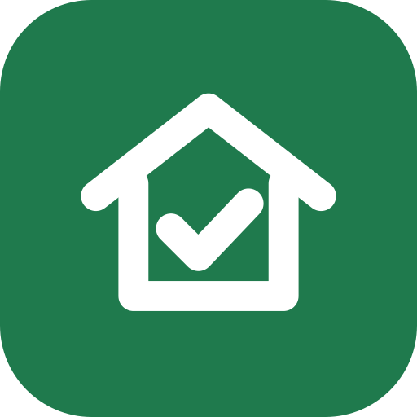
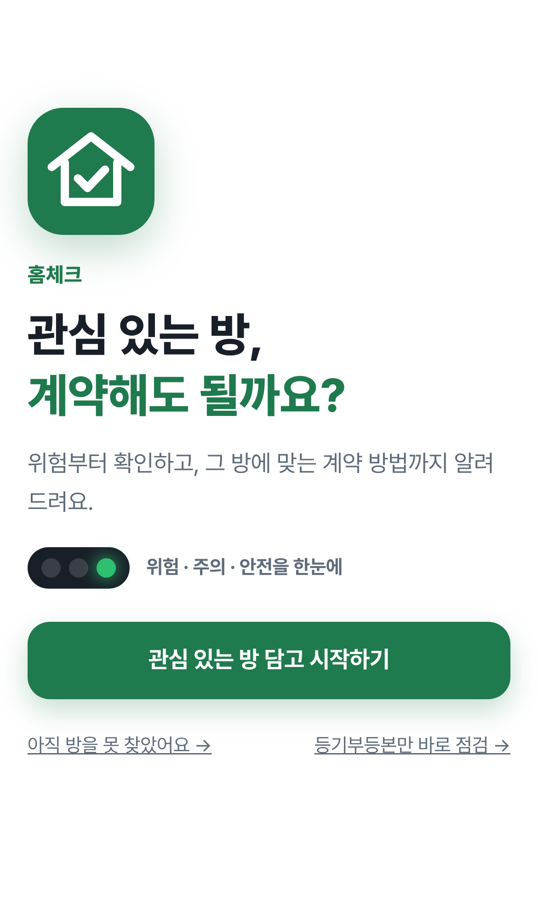
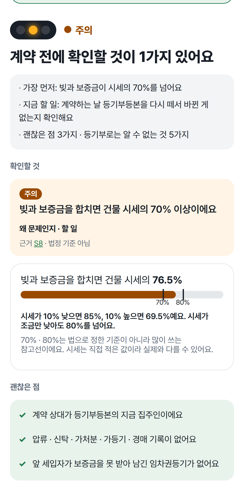
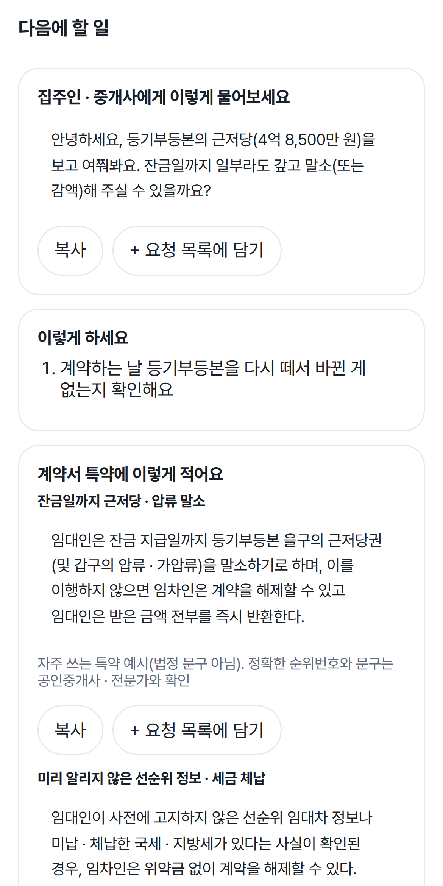
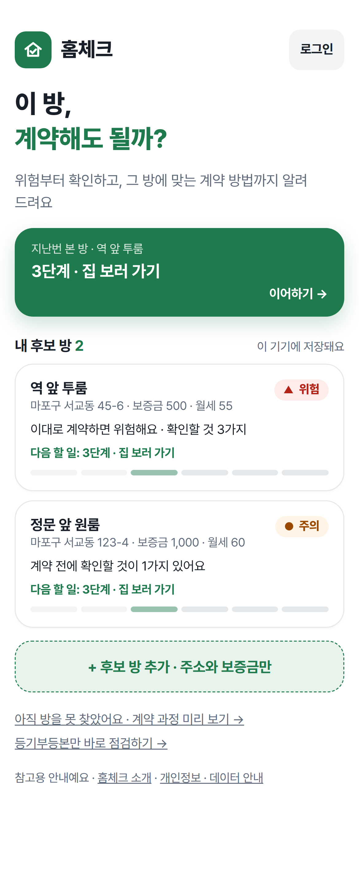
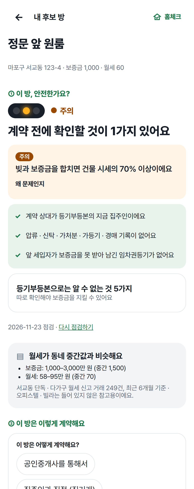
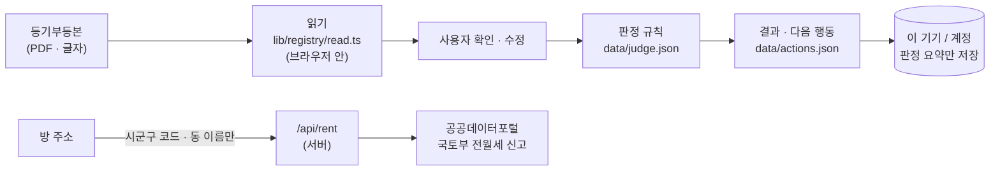

<div align="center">

<h1> 홈체크</h1>

**이 방, 계약해도 될까?**

전월세 계약 전에 등기부등본을 올리면 위험 신호를 쉬운 말로 알려 주고,<br>
그 방에 맞는 질문 · 특약 · 계약 순서까지 안내하는 모바일 웹 앱입니다.

[](https://home-check-pi.vercel.app)
[](https://github.com/dlwodns/home-check/actions/workflows/ci.yml)
[](#어떻게-동작하나)

내 컴퓨터에서 실행: `npm install && npm run dev` (Node.js 22, 키 없이도 동작) · 테스트: `npm test`

[**서비스 열기**](https://home-check-pi.vercel.app) · [사용법](#사용법) · [빠른 시작](#빠른-시작) · [판정 규칙](#판정-규칙) · [얼마나 맞나](#얼마나-맞는지-어떻게-확인했나) · [한계](#한계와-다음-단계)

</div>

<p align="center">
  
  
  
</p>

> 참고용 안내입니다. 최종 확인은 공인중개사 · 법률 전문가에게 받아 주세요.

## 왜 만들었나

> 타지역 대학에 붙은 20살. 처음으로 혼자 학교 근처 원룸을 계약해야 한다. 근저당 · 확정일자 · 전입신고는 처음 듣는 말이다. **"뭐부터 해야 할지 아무것도 모르겠다."**

- 전세사기 피해자 4만 2,039명 중 **40세 미만이 75.86%나 됩니다**(국토교통부 전세사기피해지원위원회 발표, 2026-11 보도). 처음 계약하는 사람일수록 확인 단계를 건너뜁니다.
- 기존 서비스(HUG 안심전세 앱, 각종 AI 진단)는 **확인할 줄 아는 사람**을 위한 판정 도구입니다. 판정을 들어도 "그래서 뭘 해야 하지?"가 남습니다.
- 홈체크는 **내가 고른 방 하나**에 맞춰 ① 위험을 쉬운 말로 알려 주고 ② 집주인에게 물어볼 말과 계약서에 넣을 특약까지 이어 줍니다.

대표 사례는 20살 첫 계약이지만, 처음이든 또 구하든 집을 구하는 누구나 쓸 수 있게 만들었습니다.

## 사용법

설치 · 가입 없이 배포 주소 **<https://home-check-pi.vercel.app>** 을 휴대폰으로 엽니다.

**가장 빨리 해 보기 (탭 3번)**: 첫 화면 '등기부등본만 바로 점검' → 샘플(안전 · 주의 · 위험 · 전세) 중 하나 → '점검하기'

**내 방으로 쓰기**

1. **방 담기**: '관심 있는 방 담고 시작하기' → 주소 · 보증금/월세 · (선택) 매물 링크 · 메모
2. **등기부등본 올리기**: [인터넷등기소](https://www.iros.go.kr)에서 뗀 등기부등본 PDF를 올리거나 글자를 붙여 넣습니다(열람 1,100원, 떼는 순서는 앱 안에 안내). 그림(스캔) PDF도 휴대폰 안에서 글자를 읽고, 원본 조각과 맞춰 본 뒤에 판정합니다.
3. **내 계약 정보 넣기**: 내 보증금 · 앞선 세입자 보증금 · 건물 시세 · 계약하러 올 사람. 모르면 비워 둬도 됩니다('모름'으로 따로 알림).
4. **결과 보기**: 안전 · 주의 · 위험 신호등, 이유마다 '무슨 뜻 · 왜 위험 · 할 일'과 근거 링크, 등기부로는 알 수 없는 것
5. **다음 행동**: 집주인 · 중개사에게 보낼 질문, 계약서 특약 예시, 가족에게 보낼 요약을 복사하거나 공유합니다.
6. **계약까지 따라가기**: 방마다 6단계 진행 표시(준비 → 집 찾기 → 집 보기 → 서류 확인 → 계약하는 날 → 입주 후)

| 내 후보 방 | 방 하나의 점검 · 계약 방법 |
| --- | --- |
|  |  |
| 관심 있는 방을 담고, 방마다 점검 결과와 진행 상황을 봅니다. | 점검 결과 → 동네 시세(참고) → 이 방에 맞는 계약 방법 순서로 봅니다. |

화면은 11/23 배포본에서 가짜 샘플로 찍었습니다. 화면별 자세한 설명은 [기능 자세히](docs/FEATURES.md)에 있습니다.

## 어떻게 동작하나



- **앱 안에서 AI를 부르지 않습니다.** 서류 읽기 · 위험 판정 · 설명 문장을 모두 정해진 규칙과 문장 틀로 만듭니다. 같은 서류면 항상 같은 결과가 나와 자동 테스트로 지킬 수 있고, 서류 내용이 외부로 나가지 않습니다. 개발은 Claude로 했습니다.
- **서류는 기기 밖으로 나가지 않습니다.** PDF 글자 추출과 OCR(그림 속 글자 읽기)도 브라우저 안에서 합니다. 서버로 가는 것은 동네 시세용 지역 코드뿐입니다.
- **모르면 '안전'이라고 하지 않습니다.** 못 읽은 칸, 비어 있는 시세, 보이지 않는 을구가 있으면 '주의'로 알리고, 사용자가 원본과 확인하기 전에는 '안전'을 내지 않습니다.

## 판정 규칙

기준값 · 문구 · 근거 번호는 [`data/judge.json`](data/judge.json), 계산은 [`lib/registry/judge.ts`](lib/registry/judge.ts)에 있습니다. 근거 번호(S…)는 앱의 근거 목록(`/sources`)과 [docs/SOURCES.md](docs/SOURCES.md)에서 공식 링크로 열립니다.

| 판정 | 규칙 | 근거 |
| --- | --- | --- |
| 위험 | 계약할 사람 ≠ 지금 집주인 (예전 집주인이면 따로 알림) | S11 |
| 위험 | 공동 소유인데 한 명만 계약하러 옴 | S29 · S11 |
| 위험 | 살아 있는 압류 · 가압류 · 가처분 · 가등기 · 경매개시결정 (말소된 기록은 제외) | S12 |
| 위험 | 신탁등기 | S13 |
| 위험 | 말소되지 않은 임차권등기(앞 세입자가 보증금을 못 돌려받음) | S14 |
| 위험 / 주의 | 빚 비율 80% 이상 / 70% 이상 | S8 |
| 주의 | 먼저 설정된 전세권(전세금을 빚처럼 계산) | S25 |
| 주의 | 건물 시세를 몰라 비율 계산 불가 · 앞선 세입자 보증금을 모름(다가구) | S8 · S6 · S7 |
| 주의 | 서류에서 못 읽은 칸이 있음 · 을구(빚 기록)가 보이지 않음 → 원본과 확인하기 전에는 '안전'을 내지 않음 | — |
| 참고 | 최근 6개월 안 소유권 이전 · 말소된 임차권등기 · 계약 상대 미입력 (등급에 영향 없음) | S16 · S14 · S11 |

- **빚 비율** = (살아 있는 근저당 채권최고액 합계 + 앞선 세입자 보증금 + 내 보증금) ÷ 건물 시세 × 100. 월세의 작은 보증금과 전세의 큰 보증금에 같은 식을 씁니다. **70 · 80%는 법정 기준이 아니라 많이 쓰는 참고선**이며 화면에도 그렇게 표시합니다. 시세가 10% 다를 때의 범위도 함께 보여 줍니다.
- **'안전'의 뜻**: '확인한 범위 안에서는 큰 위험 신호가 없어요'. 결과 화면에는 늘 **등기부로는 알 수 없는 것**(집주인 세금 체납 · 앞선 세입자 보증금 등)을 함께 보여 줍니다([`lib/registry/unknowns.ts`](lib/registry/unknowns.ts)).
- 보증금이 소액임차인 최우선변제 대상인지(S15)는 판정이 아니라 설명에 씁니다.
- 근거 29개 중 20개는 국가법령정보 Open API로 법령 원문과 대조했고, 7개는 원문 확인 중, 2개는 법정 기준이 아님을 앱에 그대로 표시합니다.

## 얼마나 맞는지 어떻게 확인했나

| 시험 | 결과 | 읽는 법 |
| --- | --- | --- |
| 블라인드 서류 20건 (홈체크 코드를 보지 않은 에이전트가 실제 양식대로 만들고 정답을 먼저 적음) | 고치기 전 **1차 48/60(80%) · 2차 40/60(67%)** → 원인을 고쳐 둘 다 60/60 | 처음 보는 모양에서는 67–80%. 지금은 고칠 때 본 서류라 회귀 테스트로 씀 |
| 그림 PDF OCR (가상 등기부 20건, 실제 앱 경로) | 117/120 항목 (틀린 3개는 모두 '이전 소유자', 판정에 쓰는 값은 모두 맞음) | 깨끗한 그림이고 규칙을 만들 때 본 서류라 실제 스캔보다 좋게 나왔을 수 있음 |
| 자동 테스트 | 381개, GitHub에 올릴 때마다 CI(타입 검사 → 테스트 → 빌드) | `npm test` 한 줄로 실행 |
| 배포본 점검(E2E) | `scripts/smoke.mjs`가 휴대폰 크기 브라우저로 처음부터 끝까지 눌러 봄 | 로비 · 방 담기 · 동네 시세 · 샘플은 저장 안 함 · 실제 점검 저장 · 로그인 · 404 |

자동 테스트가 확인하는 것: 샘플 4종(월세 안전 · 주의 · 위험, 전세)과 정답표(`samples/expected.json`), 근거 번호가 [근거 목록](docs/SOURCES.md)에 실제로 있는지, 등기부 읽기 · 판정, 후보 방 · 동네 시세 · 로그인 저장(합치기 · 검사), 화면 동작(사용자처럼 눌러 보기).

**실제 인터넷등기소 PDF로 잰 정확도는 아직 없습니다**([한계](#한계와-다음-단계)).

## 빠른 시작

설치 없이 써 보려면 <https://home-check-pi.vercel.app>을 엽니다. 아래는 내 컴퓨터에서 띄우는 방법입니다.

필요한 것: Node.js **22**(CI · Vercel과 같은 버전)

```bash
git clone https://github.com/dlwodns/home-check.git
cd home-check
cp .env.sample .env      # 키 이름만 든 파일. 값을 비워 둬도 실행됩니다
npm install
npm run dev              # http://localhost:3000
npm test                 # 자동 테스트
```

- 키를 비워 두면 로그인 버튼이 숨고 이 기기에만 저장되며, 동네 시세 카드만 '불러오지 못했어요'로 나옵니다. 등기부 점검 · 다음 행동 · 6단계는 모두 동작합니다.
- `npm install` 때 PDF 읽기(pdf.js)와 OCR(tesseract.js 한국어 모델) 파일이 `public/`으로 자동 복사됩니다(저장소에는 넣지 않음). 외부 CDN을 쓰지 않아 서류 그림이 기기 밖으로 나가지 않습니다.
- 프로덕션 실행: `npm run build && npm start`

### 필요한 키

| 이름 | 설명 |
| --- | --- |
| `NEXT_PUBLIC_SUPABASE_URL` | Supabase 프로젝트 주소. 없으면 로그인 버튼이 숨고 이 기기 저장만 씁니다. |
| `NEXT_PUBLIC_SUPABASE_ANON_KEY` | Supabase **공개(Publishable · anon) 키**. 브라우저에서 쓰며 권한은 DB의 RLS(본인 줄만)로 막습니다. 관리자 키(secret · service_role)는 어디에도 쓰지 않습니다. |
| `DATA_GO_KR_API_KEY` | 공공데이터포털 인증키. 동네 시세(`/api/rent`)에 씁니다. 서버에서만 읽고 응답 · 로그에 남기지 않습니다. |
| `NEXT_PUBLIC_SITE_URL` | 선택. 공유 미리보기에 쓸 사이트 주소. Vercel · Netlify에서는 자동으로 들어오므로 비워 둡니다. |
| `LAW_API_OC` | 개발할 때만. 국가법령정보 Open API 인증값으로 근거 목록을 법령 원문과 대조합니다. 앱 실행에는 필요 없습니다. |

<details>
<summary>Supabase 준비 (로그인 · 계정 저장을 쓸 때, 처음 한 번)</summary>

1. 새 프로젝트(서울 리전). Data API는 켜고, '새 테이블 자동 공개'는 끕니다.
2. SQL Editor에 [`supabase/001_user_state.sql`](supabase/001_user_state.sql)을 붙여 넣고 실행합니다 → `user_state` 표 · RLS · 계정 삭제 함수가 생깁니다.
3. Authentication → Email 켜기, **Confirm email 끄기**(가입 확인 메일을 쓰지 않음).
4. Project URL과 Publishable 키를 `.env`에 넣습니다.

</details>

<details>
<summary>샘플 PDF · OCR 측정 다시 만들기</summary>

- 샘플 PDF(`samples/pdf/`): 한글 TTF 글꼴(예: 나눔고딕, OFL) 경로를 알려 줍니다. `FONT_PATH=/경로/NanumGothic-Regular.ttf npm run samples:pdf`
- 블라인드 서류 PDF: `FONT_PATH=… node scripts/make-text-pdfs.mjs`
- OCR 정확도 측정(평소엔 건너뜀): 그림 폴더를 `OCR_IMG_DIR`로 알려 주면 `tests/ocr-measure.test.ts`가 가상 등기부 20건을 OCR로 읽어 항목별로 맞춰 봅니다.

</details>

## 기능과 진행 상태

기획 문서([미니 PRD](docs/PRD.md))에서 약속한 기능과 지금 상태입니다. '됨'은 배포본에서 바로 해 볼 수 있습니다.

| 기능 | 상태 | 배포본에서 확인하는 곳 · 뺀 것과 이유 |
| --- | --- | --- |
| F4 내 후보 방 (중심) | 됨 | 홈 → '관심 있는 방 담고 시작하기' → 방 화면(점검 결과 · 이 방 계약 방법 · 6단계 진행) |
| F2 등기부등본 점검 | 됨 | `/check` 글자 붙여 넣기 · 글자 PDF · 그림(스캔) PDF(OCR) |
| F3 다음 행동 카드 | 됨 | 점검 결과 아래: 물어볼 질문 · 할 일 · 특약 예시 · 가족 요약(복사 · 공유) · 요청 목록. 방 화면에서 중개사 / 직거래를 고르면 그 갈래의 질문 · 할 일이 맨 앞에 붙음 |
| F1 계약 6단계 길잡이 | 됨 | `/steps` 중개 / 직거래 갈래별 체크리스트, 용어 말풍선, 항목마다 근거 링크 |
| F6 동네 원룸 시세 | 됨 | 방 화면 '동네 시세'(국토부 전월세 신고, 최근 6개월 · 기준 기간과 출처 표시). 공공데이터포털이 멈추면 '불러오지 못했어요' |
| F0 로그인 · 진행 저장 | 됨 | `/login` 이메일 + 비밀번호. 로그인 없이도 모든 기능 사용. 가입 확인 메일 · 비밀번호 찾기는 뺌(무료 메일 발송이 스팸함으로 가 가입이 막힌 것처럼 보일 수 있어서) |
| F5 자주 묻는 질문 도우미 | 안 됨 | 최종 마감이 11/28로 당겨지고 포스터 제출이 추가되어, 핵심 흐름(F4 · F2 · F3)의 정확도에 시간을 씀. 용어 말풍선 · 상담 창구 카드가 일부 역할을 대신함 |

하지 않기로 한 것(매물 검색 · 매물 자동 가져오기 · 판정용 시세 자동 계산 · 법률 판단 · 서류 원문 저장)과 이유는 [PRD 6장](docs/PRD.md#6-하지-않을-것)에 있습니다.

## 서류와 개인정보

- 등기부등본은 브라우저 안에서만 읽습니다([`lib/registry/`](lib/registry/)는 화면과 분리된 순수 함수). 서버로 가는 요청은 동네 시세(`/api/rent`)의 시군구 코드 · 동 이름뿐입니다.
- 방에 저장하는 것은 주소 · 금액 · 메모 · 체크 상태 · **판정 요약**뿐이고, 등기부 원문 · 집주인 이름은 저장하지 않습니다([`lib/store/rooms.ts`](lib/store/rooms.ts)의 `Room` 타입). 샘플로 해 본 결과는 방에 저장하지 않습니다.
- 계정 저장은 Supabase `user_state` 한 표이고 RLS로 본인 줄만 읽고 씁니다([`supabase/001_user_state.sql`](supabase/001_user_state.sql)).
- 샘플 · 시험 서류는 모두 지어낸 가짜 서류입니다. 앱의 `/privacy`에서 이 기기의 기록을 한 번에 지울 수 있습니다.

## 기술 스택

| 영역 | 사용 |
| --- | --- |
| 화면 · 서버 | Next.js 16 · React · TypeScript |
| 서류 읽기 | pdf.js(글자 PDF) · tesseract.js(그림 PDF OCR), 모두 브라우저 안 |
| 저장 | 브라우저 localStorage · Supabase(Auth · Postgres · RLS) |
| 외부 데이터 | 공공데이터포털 국토교통부 단독/다가구 전월세 신고 |
| 테스트 · 배포 | Vitest · Testing Library · GitHub Actions · Vercel(서울 리전) |

## 폴더 구조

| 폴더 | 내용 |
| --- | --- |
| `app/` | 화면: 처음 화면(로비 / 내 후보 방) · `rooms/new` 방 담기 · `room/` 방 화면 · `check/` 등기부 점검 · `steps/` 6단계 · `api/rent` 동네 시세(서버) · `login/` · `account/` · `privacy/` · `sources/` 근거 목록 |
| `data/` | 판정 기준(`judge.json`) · 다음 행동 문장 틀(`actions.json`) · 6단계(`steps.json`) · 체크리스트 · 용어 사전 · 근거 목록 |
| `lib/registry/` | 등기부 읽기(`read.ts`) · 판정(`judge.ts`) · 점검 흐름(`check.ts`) · 다음 행동(`actions.ts`) · PDF(`pdf.ts`) · OCR 정리 · 확인(`ocrFix.ts` · `ocrCheck.ts`) |
| `lib/store/` · `lib/cloud/` | 이 기기 저장(후보 방 · 진행) · 로그인 후 계정 저장과 합치기 |
| `samples/` | 가짜 등기부등본: 샘플 4종 · 블라인드 시험 20건, 글자 · PDF와 정답표 |
| `tests/` | 자동 테스트 |
| `docs/` | 기획 · 근거 · 일정 문서 (아래 '문서') |

## 배포

- **Vercel**(Hobby)로 배포합니다. GitHub `main`에 올리면 자동으로 다시 배포됩니다. 서버 함수는 서울(`vercel.json`의 `icn1`).
- 모든 화면 맨 아래에 저장소 링크와 배포된 커밋 번호(앞 7자리)가 보여, 배포본이 저장소의 어느 커밋인지 맞춰 볼 수 있습니다.
- 환경 변수는 Supabase 2개 · 공공데이터 키를 Vercel → Settings → Environment Variables에 넣습니다(공공데이터 키만 Sensitive). 값을 바꾸면 Redeploy해야 반영됩니다.
- 왜 Vercel인가: 처음엔 강의대로 Netlify(`netlify.toml`이 남아 있음)에 올렸지만, 무료 계정 크레딧(운영 배포 1번 = 15, 월 300)이 이틀 만에 바닥나 배포가 멈췄고 사이트 전체 정지로 포스터 QR이 끊길 위험이 있어 11/23 옮겼습니다.

## 한계와 다음 단계

지금 알고 있는 한계(숨기지 않고 적어 둡니다)

- **인터넷등기소 열람 화면을 PDF로 저장하면 글자가 없는 그림 PDF가 됩니다(11/23 확인).** 그래서 그림 PDF를 브라우저 안에서 OCR로 읽게 했지만(11/24), **실제 등기부 PDF로 잰 정확도는 아직 없습니다.**
- 지금까지는 실제 양식을 본뜬 가짜 서류 24건(샘플 4 + 블라인드 20)으로 확인했고, 처음 보는 모양에서는 고치기 전 정확도가 67–80%였습니다.
- 판정 비율은 사용자가 적는 **건물 시세 · 앞선 세입자 보증금**에 달려 있습니다. 모르면 비워 두면 '모름'(주의)으로 알리고 '안전'을 내지 않습니다.
- 비밀번호 찾기 · 가입 확인 메일이 없습니다(앱 안에서 안내).
- 로그인(계정 저장)은 Supabase 무료 요금제라 일주일 동안 쓰는 사람이 없으면 일시정지됩니다. 그때도 로그인 없이 쓰는 기능은 모두 동작하고, 관리자가 **Resume project**를 누르면 데이터 그대로 돌아옵니다.
- 시세 API 요청 제한(같은 IP 1분 20번)은 서버 인스턴스마다 따로 세는 간단한 방식입니다.
- 무료 배포(Vercel Hobby)는 비상업 개인용 조건입니다.

다음 단계

1. 실제 PDF 여러 장으로 정확도를 다시 재고, 정규식을 덧붙이는 대신 **PDF 표 칸 위치로 읽기**
2. 건축물대장 연결(위반건축물 · 실제 용도 자동 확인)
3. 샘플 체험을 별도 '체험 모드'로, 자주 묻는 질문 도우미(F5)
4. 배포본 점검(`scripts/smoke.mjs`)을 CI에 넣어 배포마다 자동으로
5. 비밀번호 찾기 · 가입 확인 메일

## 문서

| 문서 | 내용 |
| --- | --- |
| [기능 자세히](docs/FEATURES.md) | 화면별 기능 설명 |
| [미니 PRD](docs/PRD.md) | 문제 · 타깃 · 기능 · 하지 않을 것 · 설계 원칙 |
| [근거 목록](docs/SOURCES.md) | 법 · 제도 안내의 공식 확인 링크와 확인 상태 |
| [화면 흐름](docs/FLOW.md) · [화면 벤치마킹](docs/BENCHMARK.md) | 화면 설계와 참고한 서비스 |
| [아이디어 보관함](docs/IDEAS.md) | 결정 기록(무엇을 넣고 뺐는지와 이유) |
| [7주차 점검표](docs/CHECK_7W.md) · [개발 일정](docs/SCHEDULE.md) | 자체 점검과 일정 |
| [외부 데이터 API](docs/DATA_APIS.md) · [외부 서비스 지도](docs/SERVICES.md) | 공공데이터 · 법령 API · 쓰는 서비스 |
| [포스터](poster/homecheck-poster-A2.pdf) | A2 포스터(만드는 법: [`.claude/skills/poster/SKILL.md`](.claude/skills/poster/SKILL.md)) |
